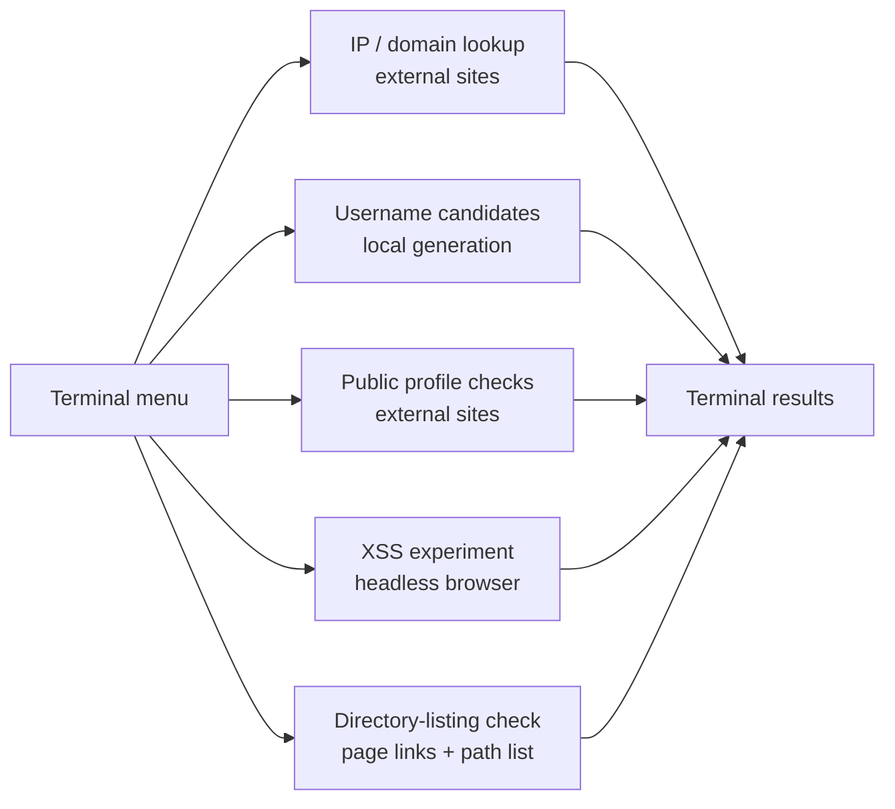

# Rosint

An interactive Python prototype that groups public-information lookups and a few web-security checks in one terminal menu. Its six options cover IP and domain lookups, username candidates, public profile checks, a browser-based XSS experiment, and directory-listing heuristics.

> **Current status:** This is a learning project, not a maintained intelligence source or a validated vulnerability scanner. Several lookups scrape third-party websites and can break when those websites change. Verify any result with the original source.

## Menu and data flow



| Option | What the code attempts | Current caveat |
| --- | --- | --- |
| 1 | IP lookup via `infobyip.com` | Parses page text with a fixed regular expression. |
| 2 | Domain lookup via `nslookup.io` | Depends on an undocumented response shape and fixed indexes. |
| 3 | Generate username variants from a first and last name | Runs locally; input should be nonempty. |
| 4 | Check public pages on GitHub, Instagram, Reddit, Steam, and Telegram | Page responses can be ambiguous or rate-limited. |
| 5 | Test a URL with XSS payloads in headless Chrome | **Currently broken:** `chromeService` and `ChromeDriverManager` are referenced but not defined or imported. |
| 6 | Check links and common paths for directory-listing text | Heuristic only; can miss or misclassify pages. |

## Run locally

Requires Python, an internet connection for options 1, 2, 4, and 6, and the packages in [`requirements.txt`](requirements.txt):

```bash
python -m pip install -r requirements.txt
python rosint.py
```

The script uses Beautiful Soup's `lxml` parser, which is included in the updated requirements file. Option 5 additionally needs Chrome and a corrected Selenium driver setup before it can run. Choose `0` to exit the menu.

## Improvement roadmap

1. Replace copied browser headers, cookies, and positional HTML parsing with documented APIs or robust parsers where available.
2. Fix the Selenium setup and add a small local test page for the XSS option; report “inconclusive” separately from “no alert.”
3. Add explicit request timeouts, status handling, and tests using saved or mocked responses.
4. Validate URLs and limit directory checks to a target the operator owns or is authorized to assess.
5. Emit structured results with source URL and retrieval time so findings can be reviewed later.

## Responsible use

Use the web-security options only against systems you own or are authorized to test. Public-profile matches are leads, not proof that accounts belong to the same person.

## License

Released under the repository's [MIT license](LICENSE).
